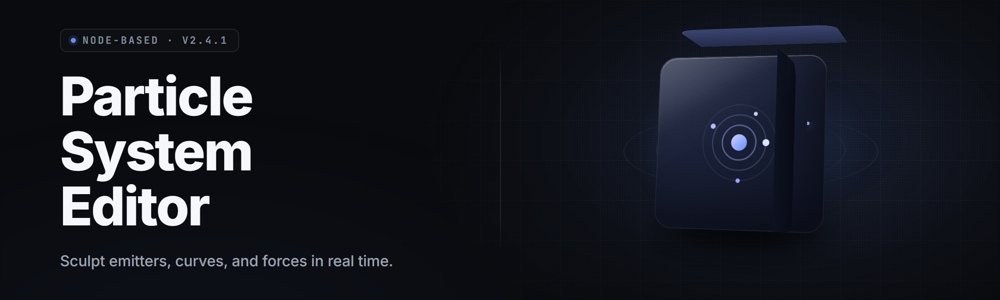

  
  
  

  

  
  
  

---

**Particle system editor** — a node-based GPU particle authoring suite for Windows, shipping as a single portable `.exe` in 2026. Build fire, smoke, sparks, magic, and destruction sims without writing a line of shader code.

  

---

## 📑 Table of Contents

- [Overview](#-overview)
- [Compatibility / Platform Support](#-compatibility--platform-support)
- [What is a Particle System Editor?](#-what-is-a-particle-system-editor)
- [Key Features](#-key-features)
- [The Problem](#-the-problem)
- [The Solution](#-the-solution)
- [Module Catalog](#-module-catalog)
  - [🛠️ Emitters & Spawning](#️-emitters--spawning)
  - [🌀 Forces & Simulation](#-forces--simulation)
  - [🎨 Rendering & Materials](#-rendering--materials)
  - [🧠 Modules & Logic](#-modules--logic)
  - [📤 Export & Interop](#-export--interop)
- [System Requirements](#-system-requirements)
- [Installation](#-installation)
- [Quick Start](#-quick-start)
- [Usage Guidelines](#-usage-guidelines)
- [Known Issues](#-known-issues)
- [Tips for Best Results](#-tips-for-best-results)
- [FAQ](#-faq)

---

## 🔭 Overview

| Category | Details |
|---|---|
| Product | Particle system editor (PSE) |
| Release | v2.4.1 "Cinderline" — 2026 |
| Platform | Windows 10 / 11 x64 |
| Distribution | Portable `.exe` — no installer, no runtime deps |
| Rendering | DirectX 12 + Vulkan backend toggle |
| File format | `.psep` project, `.pseb` baked bundle |
| License | Free for personal + commercial use |
| Engine bridges | Unity, Unreal, Godot, custom C++ runtime |

PSE is a real-time authoring tool for GPU-accelerated particle systems. You compose emitters, forces, and render passes on a node graph, preview everything live in a viewport that runs at editor framerate, then bake or export the graph to the engine of your choice. Everything lives in one `.exe` — drop it anywhere and double-click.

---

## 🖥️ Compatibility / Platform Support

| Platform | Status | Notes |
|---|---|---|
| Windows 10 (1909+) | ✅ Supported | DX12 backend recommended |
| Windows 11 | ✅ Supported | Full feature set |
| Windows 8.1 | ⚠️ Legacy | Feature-frozen, no new nodes |
| Linux (Proton) | 🧪 Experimental | Vulkan backend only |
| macOS | ❌ Not supported | No build planned |
| Unity 2021+ | ✅ Export target | VFX Graph + legacy shuriken |
| Unreal Engine 5.3+ | ✅ Export target | Niagara emitter graph |
| Godot 4.x | ✅ Export target | GPUParticles3D node |
| Custom C++ | ✅ Export target | Header-only runtime, MIT |

---

## 🧪 What is a Particle System Editor?

| Term | Explanation |
|---|---|
| Emitter | A source node that spawns particles at a rate, burst, or event |
| Module | A self-contained behavior block (gravity, turbulence, color-over-life) |
| Node graph | The visual DAG where emitters, modules, and forces connect |
| Simulation space | Local (moves with object) or World (fixed in scene) |
| Bake | Precompute a simulation into a `.pseb` bundle for cheap playback |
| Over-life curve | A value that interpolates across a particle's lifetime |
| Sub-emitter | An emitter triggered by a parent particle's birth or death event |

Core benefits of authoring in PSE:

- Live GPU preview — no round-trip to the engine to see a change
- Node graph that mirrors how Niagara and VFX Graph actually work
- Bake pipeline that turns a 40k-particle sim into a 12 KB playback file
- One tool, four export targets — stop rebuilding the same fire in every engine
- Portable `.exe` — no install, no registry writes, no admin rights

---

## ⭐ Key Features

| Feature | Description | Benefit |
|---|---|---|
| GPU-first simulation | Compute-shader solver, 1M+ particles at 60fps | Console-scale effects on desktop |
| Node graph editor | Drag/connect modules with live type checking | No shader code required |
| Curve editor | Multi-channel over-life and over-distance curves | Precise color/size/velocity control |
| Sub-emitter events | Spawn child systems on birth/death/collision | Real cascades and chain reactions |
| Collision solver | Plane, sphere, SDF, and depth-buffer collision | Particles that actually interact |
| Turbulence fields | Curl-noise + vector-field turbulence | Organic smoke and magic |
| Trail renderer | Ribbon + tube trails with UV scroll | Sword swings, comet tails |
| Bake pipeline | Precompute to `.pseb` for runtime playback | Ship without shipping the solver |
| Multi-engine export | Unity, Unreal, Godot, raw C++ | One source of truth |
| Timeline scrubber | Deterministic replay of any frame | Debug timing-dependent bugs |
| Snapshot diff | Compare two sim states side by side | Catch regressions fast |
| Profile overlay | Per-module GPU cost breakdown | Know what's expensive before ship |

---

## 🔧 The Problem

- You rebuild the same smoke plume in Unity, then again in Unreal, then again in Godot.
- Engine particle editors are locked to that engine — no cross-project reuse.
- Iteration loops are slow: tweak a curve, wait for a recompile, look, repeat.
- Sub-emitter and collision setups are painful to reason about without a graph.
- Baking is opaque: you don't know what's cheap until you profile in-engine.
- Vector-field and SDF workflows are bolted on, if they exist at all.
- Version control on particle assets is a nightmare — binary engine formats diff poorly.

---

## 🧩 The Solution

| Problem | Solution |
|---|---|
| Rebuilding effects per engine | One `.psep` graph, four export targets |
| Slow iteration loops | Live GPU viewport, no recompile to preview |
| Sub-emitter complexity | Event nodes with typed trigger ports |
| Opaque runtime cost | Profile overlay + bake cost estimate |
| Weak collision support | Native plane/sphere/SDF/depth collision modules |
| No vector-field workflow | First-class turbulence + imported vector fields |
| Binary asset diffs | Plain-text `.psep` graph, human-diffable |

---

## 🧱 Module Catalog

### 🛠️ Emitters & Spawning

| Feature | Effect |
|---|---|
| Rate emitter | Constant particles/sec with jitter |
| Burst emitter | One-shot N particles at a time offset |
| Distance emitter | Spawn per unit of emitter travel |
| Edge emitter | Spawn along mesh/spline edges |
| Volume emitter | Spawn inside mesh volume, surface, or shell |
| Sub-emitter | Trigger child emitter on parent event |

### 🌀 Forces & Simulation

| Feature | Effect |
|---|---|
| Gravity / wind | Constant + directional force with curves |
| Turbulence | Curl-noise field with frequency + strength |
| Vector field | Sample imported `.fga` / custom field |
| Vortex | Swirl around an axis with falloff |
| Attractor / repulsor | Point force with radius + strength |
| Collision | Plane, sphere, SDF, depth-buffer modes |
| Drag | Linear + quadratic, per-axis control |

### 🎨 Rendering & Materials

| Feature | Effect |
|---|---|
| Sprite renderer | Billboarded quads, atlas + flipbook |
| Mesh renderer | Instanced mesh particles, LOD-aware |
| Ribbon trail | Screen-aligned ribbon with UV scroll |
| Tube trail | Spline-swept tube geometry |
| Light renderer | GPU instanced point lights |
| Soft particles | Depth-fade against scene depth |
| Custom shader | HLSL/WGSL hook for advanced looks |

### 🧠 Modules & Logic

| Feature | Effect |
|---|---|
| Color over life | Multi-stop gradient across lifetime |
| Size over life | Curve-driven scale, world/local space |
| Velocity over life | Curve on speed and direction |
| Noise module | Per-particle noise on any channel |
| Kill conditions | Age, distance, collision, custom flag |
| Event nodes | Birth, death, collision, custom broadcast |
| Randomization | Seeded RNG with per-channel lock |

### 📤 Export & Interop

| Feature | Effect |
|---|---|
| Unity export | VFX Graph + legacy shuriken variants |
| Unreal export | Niagara emitter graph |
| Godot export | GPUParticles3D + material setup |
| C++ runtime export | Header-only MIT runtime + `.pseb` |
| Bake bundle | `.pseb` with precomputed playback |
| Graph JSON | Human-readable `.psep` export |

---

## 🖥️ System Requirements

| Component | Minimum | Recommended |
|---|---|---|
| OS | Windows 10 1909 x64 | Windows 11 22H2+ |
| CPU | 4-core 2.5 GHz | 8-core 3.5 GHz+ |
| RAM | 8 GB | 16 GB |
| GPU | DX12, 2 GB VRAM | DX12/Vulkan, 6 GB VRAM |
| Storage | 350 MB (tool) | 2 GB+ (cache + projects) |
| Display | 1280×720 | 1920×1080+ |
| Runtime | None (self-contained) | None |

---

## 📥 Installation

1. **Download the release.** Grab the latest `.exe` from the project page. No installer, no dependencies, no admin rights required.

2. **Extract to a folder.** Anywhere works — `C:\Tools\PSE\`, a USB stick, or a network share. The `.exe` is self-contained.

3. **Run the `.exe`.** Double-click. First launch creates a `PSE_Data\` folder next to the binary for cache, presets, and recent projects. Delete that folder to reset to defaults.

  

---

## ⚡ Quick Start

1. 🎬 **Launch the `.exe`** and pick *New Project* → *Empty Graph*.
2. 🛠️ **Drop an Emitter node** on the canvas, set rate to 5000/sec.
3. 🌀 **Add Gravity + Turbulence** and connect them downstream of the emitter.
4. 🎨 **Wire a Sprite renderer** and assign a soft-glow atlas from the preset library.
5. 💾 **Hit Bake**, then *Export → Unity VFX Graph* and drop the result in your scene.

---

## 📋 Usage Guidelines

| Allowed | Not allowed |
|---|---|
| Personal + commercial projects | Reselling the `.exe` itself |
| Modifying exported runtime (MIT) | Removing the license header from runtime |
| Shipping baked `.pseb` in games | Redistributing PSE as your own tool |
| Publishing preset packs | Bundling PSE in a paid installer |
| Educational + classroom use | Reverse-engineering the licensing check |
| Forking the graph format | Claiming authorship of the engine |

---

## 🐞 Known Issues

| Issue | Solution |
|---|---|
| First launch slow on HDD | Move folder to SSD; cache warms after one run |
| Vulkan backend flicker on old AMD drivers | Update to Adrenalin 24.x or switch to DX12 |
| Unreal export fails on UE 5.0 | Requires 5.3+; upgrade the engine |
| Sub-emitter count explodes | Cap `Max Sub-Emitters` in the emitter settings |
| Large `.psep` opens slowly | Split into linked sub-graphs; enable lazy load |
| Bake takes >60s on 1M particles | Reduce solver substeps or bake at half rate |

---

## 💡 Tips for Best Results

- Bake before you profile in-engine — the editor viewport is not the runtime cost.
- Use sub-emitters sparingly; each one doubles your spawn budget headroom cost.
- Curl-noise turbulence at 0.4–0.8 frequency reads as organic smoke; higher reads as chaos.
- Set simulation space to *World* for fire on moving objects, *Local* for sparks on a weapon.
- Keep `.psep` graphs under ~120 nodes; split into linked sub-graphs past that.
- Export the C++ runtime when you need deterministic replay for netcode or replays.
- Snapshot-diff before/after tuning sessions to catch accidental curve edits.

---

## ❔ FAQ

Is PSE free?

Yes. Personal and commercial use are both free under the bundled license. The exported C++ runtime is MIT.

Does it need Unity or Unreal installed?

No. PSE runs standalone. Engine exports produce files you import into that engine, but PSE itself doesn't require any engine to be present.

Can I ship baked effects without the editor?

Yes. The `.pseb` bundle plus the MIT C++ runtime is enough to play back a baked sim in any project.

Why does my 1M-particle sim drop frames?

The editor viewport runs the same solver as runtime but with debug overhead. Bake, then profile in-engine for real numbers. Also check the profile overlay for the expensive module.

Does it work on Linux?

Via Proton + the Vulkan backend, experimentally. No native Linux build is planned for 2026.

How do I update?

Download the new `.exe` and replace the old one. Your `PSE_Data\` folder and projects carry over — no migration step needed.

Can I import existing Unity VFX or Niagara graphs?

Import is partial: VFX Graph and Niagara topologies are read as a starting graph, but custom HLSL/HLSL nodes are stubbed and need manual reauthoring.

Is the graph format text or binary?

Text. `.psep` is JSON with a stable schema, so it diffs cleanly in git.

What's the difference between Bake and Export?

*Export* translates the graph into an engine-native asset. *Bake* precomputes the simulation into a `.pseb` playback bundle for the C++ runtime.

Can I write my own modules?

Yes — the custom shader hook and the C++ runtime both accept user modules. A plugin SDK ships with the editor.

---

Particle system editor in 2026 is one `.exe`, one graph, four export targets. Build the effect once, ship it everywhere, and stop rebuilding fire in every engine you touch. Everything you need is in the portable binary — extract, run, and start authoring.
